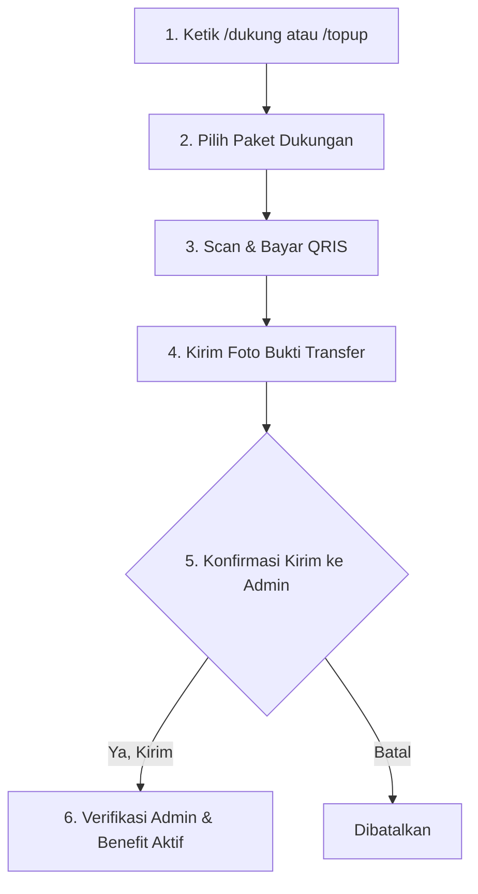

# 📖 Panduan Pengguna Bot (User Guide)
> **Selamat datang di Panduan Lengkap Bot Telegram!**  
> Dokumen ini dirancang khusus untuk memandu Anda menikmati seluruh fitur bot: mulai dari mengunduh media, mencatat keuangan pribadi & keluarga, hingga bermain game multiplayer bersama teman di grup.

---

## 📑 Daftar Isi
1. [Memulai & Navigasi Bot](#1-memulai--navigasi-bot)
2. [Fitur Download Media](#2-fitur-download-media)
3. [Catat Keuangan Cerdas (AI)](#3-catat-keuangan-cerdas-ai)
4. [Kas Grup & Keuangan Keluarga](#4-kas-grup--keuangan-keluarga)
5. [Arena Permainan (Mini-Games)](#5-arena-permainan-mini-games)
6. [Sistem Koin & Level EXP](#6-sistem-koin--level-exp)
7. [Panduan Top-Up Koin & Alur Pembayaran QRIS](#7-panduan-top-up-koin--alur-pembayaran-qris)
8. [Status Keanggotaan: Free vs VIP](#8-status-keanggotaan-free-vs-vip)
9. [Panduan Khusus Menggunakan Bot di Grup Telegram](#9-panduan-khusus-menggunakan-bot-di-grup-telegram)
10. [Daftar Perintah Lengkap (Cheatsheet)](#10-daftar-perintah-lengkap-cheatsheet)
11. [Pertanyaan yang Sering Diajukan (FAQ)](#11-pertanyaan-yang-sering-diajukan-faq)

---

## 1. Memulai & Navigasi Bot

Bot ini mengusung konsep **Button-First UX** — Anda tidak perlu repot mengetik perintah yang rumit, cukup tekan tombol menu yang tersedia di layar Telegram Anda!

* Ketik **/start** atau **/menu** untuk membuka dashboard utama bot:
  * 🎮 **Arena Games:** Buka katalog aneka game seru.
  * 💰 **Keuangan & Dompet:** Catat pengeluaran dan lihat rekap keuangan Anda.
  * 💳 **Dukungan & Paket Berbayar (QRIS):** Pembelian paket koin & VIP resmi via QRIS.
  * 🎁 **Klaim Harian:** Ambil koin dan EXP gratis setiap 24 jam.
  * 📊 **Profil & Statistik:** Cek level, sisa kuota, dan winrate game.
  * 🔗 **Referral:** Bagikan link undangan untuk mendapatkan bonus koin.
  * ℹ️ **Bantuan & Kontak Admin:** Panduan lengkap bot serta akses langsung chat ke Administrator.

---

## 2. Fitur Download Media

Anda bisa mengunduh video, musik (MP3), atau album foto dari berbagai platform media sosial secara gratis dan instan.

### Platform yang Didukung:
* **YouTube:** Video (pilihan resolusi 720p, 360p) atau Audio MP3 saja.
* **TikTok:** Video jernih tanpa watermark (No Watermark).
* **Instagram:** Reels, postingan video feed, foto tunggal, dan carousel/album (banyak foto sekaligus).
* **X / Twitter:** Video, audio, dan multi-image.
* **Threads:** Postingan video maupun galeri album foto.
* **Facebook:** Video biasa dan FB Reels.
* **Reddit & Pinterest:** Video dan pin gambar beresolusi tinggi.
* **Bilibili / Bstation:** Video streaming anime dan konten kreator.

### Cara Mengunduh:
1. **Salin tautan (link)** media dari aplikasi (misal: tombol *Bagikan* $\to$ *Salin Tautan* di Instagram/TikTok/YouTube).
2. **Kirim/Tempelkan (Paste)** link tersebut langsung ke obrolan bot.
3. Bot akan memeriksa link dan menampilkan tombol pilihan format (misal: `🎬 Video` atau `🎵 Audio MP3`).
4. Tekan tombol format yang Anda inginkan, bot akan mengunduh dan mengirimkannya ke chat Anda.

> 💡 **Info Batas Ukuran File (50MB):**  
> Telegram membatasi bot mengirim file di atas 50MB. Jika video yang Anda unduh berukuran lebih dari 50MB, bot akan otomatis menyediakan tombol **🌐 Unduh Langsung via Browser** (agar Anda bisa mengunduh langsung ke ponsel tanpa gagal) atau pilihan **🎧 Unduh Audio MP3 Saja**.

---

## 3. Catat Keuangan Cerdas (AI)

Tidak perlu repot memasukkan angka dan memilih kategori secara manual! Bot dilengkapi kecerdasan buatan (AI) Google Gemini yang memahami bahasa sehari-hari dan mampu membaca foto struk belanja Anda.

### A. Catat Lewat Kalimat Cerita (Teks)
Cukup ceritakan pengeluaran Anda dengan bahasa santai / gaul:
* `beli soto ayam 15k di warung pak kumis`
* `isi bensin pertalite 50rb`
* `ngopi janji jiwa habis 28000`
* `bayar tagihan listrik pln 250rb`

**Cara Catat:**
1. Buka menu **/keuangan** lalu tekan tombol **`📝 Catat Pengeluaran`**.
2. Ketik cerita belanja Anda, lalu kirim.
3. AI akan otomatis mendeteksi:
   * 💰 **Nominal:** (misal: Rp 15.000)
   * 🏷️ **Kategori:** (misal: 🍜 Makanan & Minuman)
   * 🏢 **Tempat / Merchant:** (misal: Warung Pak Kumis)
   * 📦 **Rincian Item:** (misal: Soto Ayam)

### B. Scan Foto Struk Belanja (AI Vision)
Punya nota atau struk belanja dari supermarket, minimarket, atau restoran?
1. Buka menu **/keuangan** lalu tekan tombol **`🧾 Scan Struk`** (atau ketik **/struk**).
2. Kirimkan foto struk belanja Anda.
3. AI akan membaca total nominal belanja, rincian barang, dan nama toko secara otomatis!

### C. Mengelola Kartu Pengeluaran
Setiap kali pengeluaran berhasil dicatat, bot menampilkan kartu interaktif:
* **`🏷️ Ganti Kategori`:** Ganti kategori jika ingin memindahkannya (cth: dari *Lainnya* ke *Belanja Harian*).
* **`📝 Tambah / Edit Catatan`:** Beri catatan kustom (cth: *"Reimburse kantor"* atau *"Titipan tetangga"*).
* **`🗑️ Hapus`:** Batalkan dan hapus transaksi dari pembukuan jika ada kesalahan.

### D. Melihat Laporan Dompet Pribadi
Ketik **/keuangan** di chat pribadi dengan bot untuk melihat:
* 📅 Total pengeluaran **Hari Ini**.
* 🗓️ Total pengeluaran **Bulan Ini**.
* 🏷️ **Persentase per Kategori** (Makanan, Transportasi, Belanja, Tagihan, dll).
* 📝 **5 Riwayat Belanja Terakhir**.

---

## 4. Kas Grup & Keuangan Keluarga

Ingin mengatur keuangan rumah tangga bersama pasangan atau keluarga? Anda cukup membuat grup Telegram (misal berisi Ayah, Ibu, dan Anak) lalu undang bot ke dalam grup tersebut!

### Cara Kerja Kas Keluarga di Grup:
1. **Catat Bersama:** Siapa pun anggota keluarga di grup bisa mencatat belanja keluarga (bisa via teks maupun foto struk belanjaan).
2. **Koin Tetap Pribadi:** Biaya koin AI (5 koin teks / 10 koin struk; gratis untuk VIP) selalu **dipotong dari koin pribadi masing-masing anggota** yang mencatat, bukan koin grup!
3. **Identitas Pencatat:** Transaksi di grup otomatis mencantumkan nama yang berbelanja (misal: `👤 Dicatat oleh: Ayah`).

### Tombol "📌 Simpan juga di Pribadi"
Saat Ayah mencatat pengeluaran di grup keluarga, pada kartu transaksi akan muncul tombol:
* **`[ 📌 Simpan juga di Pribadi ]`**: Jika ditekan oleh Ayah, catatan tersebut otomatis disalin ke **buku kas pribadi Ayah**.
* Tombol akan berubah menjadi **`[ ✅ Tersimpan di Pribadi ]`**.
* *Proteksi:* Anggota lain tidak bisa menekan tombol ini untuk melindungi privasi akun masing-masing.

### Laporan Kas Grup:
Ketik **/keuangan** langsung di dalam grup keluarga untuk melihat:
* 📅 Total kas keluar hari ini di keluarga.
* 🗓️ Total belanja bersama bulan ini.
* 👥 **Kontribusi Anggota Bulan Ini:**
  * `• 👤 Ayah: Rp 1.500.000 (12 transaksi · 45%)`
  * `• 👤 Ibu: Rp 1.700.000 (18 transaksi · 51%)`
  * `• 👤 Anak: Rp 120.000 (2 transaksi · 4%)`
* 🏷️ Rincian belanja keluarga per kategori.
* 📝 5 Pengeluaran kas terakhir di grup.

---

## 5. Arena Permainan (Mini-Games)

Kumpulkan koin game sambil bersenang-senang! Seluruh permainan dapat dimainkan secara solo maupun multiplayer di dalam grup.

### 1. ❌⭕ Tic Tac Toe (`/ttt`)
* **Lawan Bot AI (Solo):** Asah strategi duel 3x3 melawan Bot AI.
* **Lawan Teman (PvP di Grup):**
  1. Ketik `/ttt` di grup, pilih *Lawan Teman (PvP)*, lalu tentukan taruhan koin (Santai / 5 / 10 / 25 koin).
  2. Bot akan mengirim kartu tantangan di grup dengan tombol **`⚔️ Terima Tantangan!`**.
  3. Teman Anda cukup menekan tombol tersebut, lalu bertanding bergiliran di pesan grup!
  4. Pemenang duel mengambil seluruh pot koin taruhan!

### 2. 👨‍👩‍👧‍👦 Family 100 (`/family100` atau `/f100`)
* Kuis survei seru berisi ribuan pertanyaan populer.
* Di grup, **seluruh anggota bisa berlomba-lomba mengetik tebakan** langsung di chat.
* Siapa yang jawabannya cocok dengan survei, namanya akan tercatat di papan dan **mendapatkan +2 Koin & +1 EXP** per jawaban benar!
* Jika waktu habis (60 detik) dan belum ada satu pun jawaban yang tertebak, inisiator game dikenakan penalti -10 koin.

### 3. 🖼️ Tebak Gambar (`/tebakgambar` atau `/tg`)
* Bot mengirimkan foto teka-teki gambar beserta petunjuk jumlah kata & huruf.
* Seluruh anggota grup berlomba mengetik tebakannya di chat.
* Anggota pertama yang menebak dengan tepat mendapat **+4 Koin & +2 EXP** (atau +2 koin & +1 EXP jika menggunakan tombol clue)!
* Waktu menjawab adalah 30 detik.

### 4. 🎲 Dadu Keberuntungan (`/dice <taruhan>`)
* Contoh: `/dice 10` (Minimal taruhan 5 koin).
* Bot dan Anda akan melempar dadu virtual dengan animasi Telegram fisik.
* Jika angka dadu Anda lebih tinggi dari bot, Anda memenangkan **2x lipat taruhan**!

### 5. 🎰 Mesin Slot (`/slot <taruhan>`)
* Contoh: `/slot 20` (Minimal taruhan 5 koin).
* Putar 3 baris reel slot animasi Telegram.
* Multiplier Hadiah:
  * 🔥 **Jackpot 777:** 10x lipat taruhan!
  * 💎 **Triple BAR:** 5x lipat taruhan!
  * 🍒 **Triple Buah:** 4x lipat taruhan!
  * ✨ **Dua Simbol Kembar:** 1.5x lipat taruhan!

### 6. 🧩 Kuis Tebak-Tebakan (`/tebak`)
* Teka-teki kocak dengan 4 pilihan ganda (A, B, C, D).
* Jawaban benar mendapatkan **+2 Koin & +1 EXP**.
* Salah atau menyerah dikenakan potongan -5 koin.

---

## 6. Sistem Koin & Level EXP

Koin dan EXP adalah mata uang virtual di dalam bot yang bisa Anda kumpulkan untuk berbagai manfaat.

### A. Kegunaan Koin:
1. **Download Media:** 5 Koin per unduhan (Free User).
2. **Catat Keuangan AI:** 5 Koin per catatan teks, 10 Koin per scan struk (Free User).
3. **Taruhan Game:** Bermain Dadu, Slot, dan Tic Tac Toe PvP.
4. **Tukar Status VIP (`/tukar`):**
   * 🌟 **VIP 7 Hari:** 500 Koin.
   * 👑 **VIP 30 Hari:** 1.500 Koin.

### B. Cara Mendapatkan Koin Gratis:
* 🎁 **Bonus Pengguna Baru:** Otomatis mendapat modal awal **500 Koin**.
* 🎁 **Klaim Harian (`/claim`):** Dapatkan **+50 Koin & +10 EXP gratis** setiap 24 jam.
* 🎮 **Menangkan Game:** Mainkan Family 100, Tebak Gambar, Dadu, Slot, dan Kuis.
* 🔗 **Ajak Teman (`/ref`):** Dapatkan **+500 Koin & +10 EXP** untuk setiap teman yang bergabung lewat link referral Anda!
* 💳 **Dukung Tools Ini (`/dukung` atau `/topup`):** Beli paket koin & VIP via QRIS Otomatis (didukung BCA, Mandiri, BRI, BNI, Dana, OVO, Gopay, ShopeePay).

### C. Perhitungan EXP sebagai Indikator Keaktifan Pengguna:
EXP (**Experience Points**) adalah skor reputasi dan indikator keaktifan pengguna dalam menggunakan seluruh fitur bot:

| Aktivitas Pengguna | Perolehan EXP | Keterangan |
|---|:---:|---|
| 📥 **Download Media Berhasil** | **+2 EXP** | Diberikan setiap kali selesai mengunduh video/audio/album |
| 📝 **Catat Pengeluaran (Teks)** | **+3 EXP** | Diberikan saat AI berhasil mencatat cerita belanja |
| 🧾 **Scan Struk Belanja (AI)** | **+5 EXP** | Diberikan saat AI Vision berhasil membaca struk |
| 🎁 **Klaim Bonus Harian (`/claim`)** | **+10 EXP** | Diberikan setiap kali klaim harian 24 jam |
| 🔗 **Mengajak Teman (`/ref`)** | **+10 EXP** | Diberikan per teman baru yang bergabung lewat link Anda |
| 👨‍👩‍👧‍👦 **Tebakan Benar Family 100** | **+1 EXP** | Diberikan untuk setiap tebakan survei yang benar |
| 🖼️ **Menjawab Benar Tebak Gambar** | **+2 EXP** | Diberikan saat berhasil menebak gambar (+1 EXP jika pakai clue) |
| 🧩 **Kuis Tebak-Tebakan Benar** | **+1 EXP** | Diberikan jika memilih jawaban kuis dengan benar |
| ❌⭕ **Menang Tic Tac Toe (PvP/AI)** | **+1 s/d +3 EXP** | Poin taktik saat memenangkan duel atau seri |
| 🎲 **Menang Lempar Dadu (`/dice`)** | **+5 s/d +15 EXP** | Bonus keberuntungan saat mengalahkan dadu bot |
| 💳 **Dukung Tools (Beli Paket QRIS)** | **+10 s/d +250 EXP** | Apresiasi loyalitas saat mendukung kelangsungan server |

### D. Sistem Peringkat & Level:
Rumus kenaikan level: `Level = Math.floor(EXP / 100) + 1` *(Setiap 100 EXP otomatis naik 1 level)*:
* 🌱 **Pemula:** Level 1 – 4 (0 – 499 EXP)
* ⚔️ **Petualang:** Level 5 – 14 (500 – 1.499 EXP)
* 🛡️ **Pendekar:** Level 15 – 29 (1.500 – 2.999 EXP)
* 👑 **Sultan:** Level 30 – 49 (3.000 – 4.999 EXP)
* ⚡ **Legenda:** Level 50+ (5.000+ EXP)

Peringkat master EXP tertinggi di seluruh bot dapat dicek dengan mengetik **/leaderboard**!

---

## 7. Dukung Pengembangan Tools Ini dengan Beli Paket Berbayar (QRIS)

Bantu kami menjaga bot dan infrastruktur server tetap aktif, cepat, dan selalu diperbarui dengan membeli **Paket Berbayar Resmi**. Pembayaran didukung penuh via metode **QRIS** (BCA, Mandiri, BRI, BNI, Dana, GoPay, OVO, ShopeePay, LinkAja, dll). Setiap kontribusi Anda sangat berarti untuk biaya operasional server.

### A. Pilihan Paket Dukungan Berbayar:

| Paket | Benefit Koin | Benefit Spesial | Nominal Dukungan |
|---|:---:|---|:---:|
| 🥉 **Paket Starter** | **+200 Koin** | Akses puluhan unduhan media | **Rp 5.000** |
| 🥈 **Paket Pro** ⭐ | **+500 Koin** | Pilihan terpopuler & hemat | **Rp 10.000** |
| 🥇 **Paket Sultan** | **+1.200 Koin** | Bonus ekstra **+200 Koin** | **Rp 20.000** |
| 👑 **Paket VIP Sultan** | **+2.000 Koin** | **VIP Member Aktif 30 Hari Bebas Unduh** | **Rp 35.000** |

---

### B. Alur Pembayaran Langkah demi Langkah:

1. **Buka Menu Paket Dukungan:**
   * Ketik perintah `/dukung` atau `/topup` di obrolan pribadi dengan bot, atau tekan tombol **`💖 Dukung Bot (Paket Berbayar)`** di menu utama `/start`.
2. **Pilih Paket yang Diinginkan:**
   * Tekan tombol paket pilihan Anda (contoh: `🥈 Paket Pro (500 Koin - Rp 10rb) ⭐`).
   * Bot akan langsung menampilkan gambar kode **QRIS Dinamis** beserta rincian pesanan dan total pembayaran.
3. **Pindai & Bayar:**
   * Buka aplikasi mobile banking atau e-wallet pilihan Anda (BCA, Mandiri, GoPay, Dana, OVO, ShopeePay, dll).
   * Pilih menu **Scan QR / QRIS** lalu arahkan kamera ke kode QRIS yang dikirimkan bot.
   * Lakukan pembayaran sesuai dengan nominal tagihan yang tertera.
4. **Kirim Foto Bukti Transfer:**
   * Setelah pembayaran berhasil, simpan tangkapan layar (screenshot) bukti transfer Anda.
   * Kirimkan foto bukti transfer tersebut langsung ke ruang obrolan bot.
5. **Konfirmasi Pengiriman Bukti:**
   * Bot akan menampilkan kartu konfirmasi dengan dua pilihan tombol:
     * **`[ ✅ Ya, Kirim ke Admin ]`**: Tekan tombol ini untuk meneruskan bukti transfer Anda ke tim Administrator.
     * **`[ ❌ Bukan / Batalkan ]`**: Tekan jika Anda tidak sengaja mengirim foto yang salah.
6. **Verifikasi Admin & Benefit Otomatis Masuk:**
   * Tim Admin akan memverifikasi mutasi transaksi Anda.
   * Setelah diverifikasi, koin (dan status VIP jika memilih paket VIP) akan langsung aktif di akun Anda dan bot mengirimkan notifikasi apresiasi!

---

### C. Ketentuan & Layanan Bantuan (CS):
* ⏱️ **Batas Waktu Pembayaran:** Setiap pesanan berlaku selama **30 menit**.
* ❌ **Batalkan Pesanan:** Jika Anda ingin mengganti paket sebelum membayar, cukup tekan tombol **`❌ Batalkan Pesanan`** pada pesan kode QRIS.
* 💬 **Bantuan Kendala QRIS:** Jika saldo koin belum bertambah setelah transfer atau Anda butuh bantuan, gunakan:
  * Tombol **`💬 Tanya Admin / CS`** pada katalog menu `/topup`.
  * Tombol **`💬 Butuh Bantuan?`** di bawah gambar kode QRIS (pesan otomatis terisi dengan *Order ID* Anda).
* 🛡️ **Klarifikasi Penolakan Transfer:** Jika struk Anda tidak sengaja ditolak karena nominal tidak pas atau foto buram, bot akan mengirimkan tombol **`[💬 Hubungi Admin]`** agar Anda bisa langsung mengonfirmasi mutasi rekening ke Admin.
* 🔒 **Aman & Terpercaya:** Pembayaran diproses dengan standar QRIS Nasional Indonesia dan diverifikasi langsung oleh Administrator.

---

## 8. Status Keanggotaan: Free vs VIP

| Manfaat & Fitur | 👤 Free User | 🌟 VIP Member |
|---|---|---|
| **Batas Unduhan Harian** | **Tanpa Batas** *(selama saldo koin cukup)* | **Tanpa Batas** *(Bebas koin)* |
| **Biaya Koin per Unduhan** | 5 Koin / unduhan | **GRATIS (0 Koin)** |
| **Biaya Catat Keuangan Teks** | 5 Koin / catatan | **GRATIS (0 Koin)** |
| **Biaya Scan Foto Struk** | 10 Koin / scan | **GRATIS (0 Koin)** |
| **Badge Profil** | 👤 Free User | 🌟 VIP Member |
| **Prioritas Antrean Server** | Standar | Prioritas Tinggi |

### Cara Menjadi Member VIP:
1. **Tukar Koin Game:** Ketik `/tukar` lalu tukar 500 koin (VIP 7 hari) atau 1.500 koin (VIP 30 hari).
2. **Beli via Admin:** Hubungi admin dengan bukti transfer bank/e-wallet untuk aktivasi manual.

---

## 9. Panduan Khusus Menggunakan Bot di Grup Telegram

Agar bot dapat berjalan optimal saat dimasukkan ke dalam grup (terutama untuk game interaktif seperti Family 100 dan Tebak Gambar), pastikan konfigurasi berikut:

> [!IMPORTANT]
> **Cara Mengaktifkan Pembacaan Pesan di Grup (Group Privacy Mode):**  
> Telegram secara default menyalakan fitur *Privacy Mode* sehingga bot tidak bisa membaca pesan teks biasa (hanya membaca pesan berawalan `/`).  
> 
> Agar anggota grup bisa langsung mengetik jawaban tebak-tebakan tanpa perlu mention atau garis miring:
> 1. Buka bot resmi **[@BotFather](https://t.me/BotFather)** di Telegram.
> 2. Ketik perintah `/setprivacy`.
> 3. Pilih bot Anda (contoh: `@ivy_your_assistant_bot`).
> 4. Pilih tombol **`Disable`**.
> 5. *(Alternatif lain: Jadikan bot sebagai **Admin Grup** dengan hak membaca pesan).*

---

## 10. Daftar Perintah Lengkap (Cheatsheet)

### 📌 Navigasi & Akun
* `/start` — Memulai bot dan membuka menu navigasi utama.
* `/menu` — Pintasan cepat ke keyboard menu bot.
* `/profile` — Cek status akun, level, saldo koin, dan sisa kuota hari ini.
* `/ref` — Dapatkan link referral undangan Anda.
* `/help` — Buka panduan lengkap bot interaktif dilengkapi tombol hubungi Admin CS.

### 💰 Keuangan & Kas Keluarga
* `/keuangan` atau `/laporan` — Buka ringkasan dompet pribadi atau kas grup.
* `/catat <cerita>` — Catat pengeluaran instan lewat cerita teks belanja.
* `/struk` — Mulai scan foto struk belanja otomatis dengan AI.

### 🎮 Permainan & Koin
* `/games` — Buka arena dashboard permainan mini-games.
* `/ttt` atau `/tictactoe` — Buka arena duel Tic Tac Toe (Solo / PvP).
* `/family100` atau `/f100` — Mulai permainan kuis survei Family 100.
* `/nyerah_f100` — Menyerah dari ronde Family 100 yang sedang berjalan.
* `/tebakgambar` atau `/tg` — Mulai permainan Tebak Gambar.
* `/nyerah` — Menyerah dari ronde Tebak Gambar.
* `/dice <koin>` — Bermain lempar dadu berhadiah koin melawan bot.
* `/slot <koin>` — Memutar mesin slot mini Telegram.
* `/tebak` — Kuis tebak-tebakan pilihan ganda interaktif.
* `/claim` — Klaim bonus +50 koin dan +10 EXP harian gratis.
* `/koin` — Cek saldo koin, level, dan ringkasan statistik menang.
* `/tukar` — Tukar koin game menjadi status VIP 7 Hari / 30 Hari.
* `/topup` atau `/dukung` — Dukung pengembangan tools ini dengan beli paket berbayar via QRIS.
* `/leaderboard` — Lihat 10 pemain terkaya dan level tertinggi.

---

## 11. Pertanyaan yang Sering Diajukan (FAQ)

**Q: Mengapa bot tidak merespons tebakan kata di grup pada game Family 100?**  
A: Pastikan *Privacy Mode* bot di `@BotFather` sudah di-set ke **Disable**, atau jadikan bot sebagai Admin grup (lihat [Bagian 9](#9-panduan-khusus-menggunakan-bot-di-grup-telegram)).

**Q: Jika saya mencatat pengeluaran di grup keluarga, apakah koin grup yang dipotong?**  
A: Tidak. Koin yang terpotong adalah **koin pribadi akun Anda** yang mengirim pesan. Anggota keluarga lain tidak akan berkurang koinnya.

**Q: Apakah anggota keluarga di grup bisa melihat isi dompet pribadi saya?**  
A: Tidak. Rekapitulasi dompet pribadi Anda hanya bisa dilihat oleh Anda sendiri saat mengetik `/keuangan` di ruang obrolan pribadi dengan bot. Di grup, bot hanya menampilkan total pengeluaran bersama (kas keluarga).

**Q: Mengapa video YouTube Shorts yang saya unduh berformat 720p bukan 1080p?**  
A: Bot otomatis memilih resolusi optimal (720p) yang memiliki keseimbangan sempurna antara kualitas visual yang tajam dan ukuran file yang aman di bawah batas limit 50MB Telegram.

**Q: Apakah ada batasan jumlah unduhan per hari?**  
A: **Tidak ada batasan harian!** Bot menggunakan sistem ekonomi koin, sehingga Anda bebas mengunduh media sebanyak apa pun setiap hari tanpa limit kuota harian, selama saldo koin Anda mencukupi (5 koin per unduhan untuk Free User, atau **GRATIS sepuasnya tanpa koin** untuk member VIP & Admin).

**Q: Bagaimana jika pembayaran QRIS saya bermasalah atau koin belum masuk?**  
A: Cukup tekan tombol **`💬 Butuh Bantuan?`** pada pesan gambar QRIS Anda atau tekan **`💬 Tanya Admin / CS`** di menu `/topup`. Anda akan langsung terhubung ke obrolan pribadi dengan Administrator dengan format Order ID yang sudah terisi otomatis.

**Q: Bagaimana cara menghubungi Admin jika mengalami kendala bot atau ada saran fitur?**  
A: Anda dapat menekan tombol **`ℹ️ Bantuan & Kontak Admin`** dari menu utama `/start` atau ketik perintah `/help`, lalu tekan tombol **`[💬 Hubungi Admin]`**.

---

*Selamat menikmati layanan bot! Jika menemukan kendala atau memiliki pertanyaan lebih lanjut, silakan hubungi Administrator bot.*
